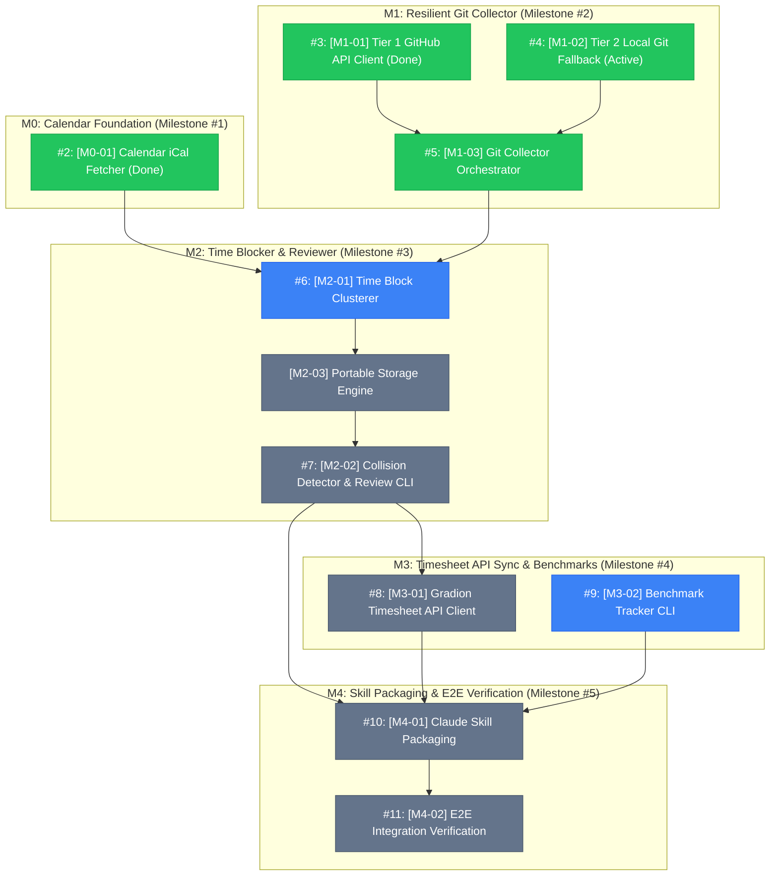

# Tracer-bullet tickets (Matt Pocock format)

This directory contains the full vertical-slice ticket breakdown for Personal Pilot Timesheet Logger (Assignment 1).

Each ticket is designed to fit inside a single agent context window, has explicit blocking edges, declares strict interface seams, and specifies deterministic verification commands.

---

## Ticket dependency graph

---

## Ticket index and live issues

| Issue | Local ticket | Title | Milestone | Status | Blocked by | Blocks |
|---|---|---|---|---|---|---|
| [#2](https://github.com/huyle-gradion/personal-pilot-timesheet-logger/issues/2) | [M0-01](file:///Users/huy.leminh/Projects/assignment-1/.tickets/M0-01-calendar-fetcher.md) | Calendar iCal Fetcher | M0: Calendar Foundation | **Done (PR #1)** | None | #6 |
| [#3](https://github.com/huyle-gradion/personal-pilot-timesheet-logger/issues/3) | [M1-01](file:///Users/huy.leminh/Projects/assignment-1/.tickets/M1-01-github-api-client.md) | Tier 1 GitHub REST API Client | M1: Git Collector | **Done (PR #12)** | None | #5 |
| [#4](https://github.com/huyle-gradion/personal-pilot-timesheet-logger/issues/4) | [M1-02](file:///Users/huy.leminh/Projects/assignment-1/.tickets/M1-02-local-git-fallback.md) | Tier 2 Local Git History Parser | M1: Git Collector | **Done (PR #13)** | None | #5 |
| [#5](https://github.com/huyle-gradion/personal-pilot-timesheet-logger/issues/5) | [M1-03](file:///Users/huy.leminh/Projects/assignment-1/.tickets/M1-03-git-collector-orchestrator.md) | Git Collector Orchestrator CLI | M1: Git Collector | **Done (PR #13)** | #3, #4 | #6 |
| [#6](https://github.com/huyle-gradion/personal-pilot-timesheet-logger/issues/6) | [M2-01](file:///Users/huy.leminh/Projects/assignment-1/.tickets/M2-01-time-block-clusterer.md) | Time Block Clusterer & Focus Spans | M2: Time Blocker | **Active (PR #14)** | None | M2-03 |
| - | [M2-03](file:///Users/huy.leminh/Projects/assignment-1/.tickets/M2-03-portable-storage-engine.md) | Portable 3-Tier Storage Engine | M2: Time Blocker | **Ready to Implement** | #6 | #7 |
| [#7](https://github.com/huyle-gradion/personal-pilot-timesheet-logger/issues/7) | [M2-02](file:///Users/huy.leminh/Projects/assignment-1/.tickets/M2-02-collision-detector-review-cli.md) | Collision Detector & Review CLI | M2: Time Blocker | Blocked | #6, M2-03 | #8, #10 |
| [#8](https://github.com/huyle-gradion/personal-pilot-timesheet-logger/issues/8) | [M3-01](file:///Users/huy.leminh/Projects/assignment-1/.tickets/M3-01-gradion-api-reconciliation.md) | Gradion Timesheet API Client | M3: API Sync | Blocked | #7 | #10 |
| [#9](https://github.com/huyle-gradion/personal-pilot-timesheet-logger/issues/9) | [M3-02](file:///Users/huy.leminh/Projects/assignment-1/.tickets/M3-02-benchmark-tracker-cli.md) | Benchmark Tracker CLI & Parser | M3: Benchmarking | **Ready to Implement** | None | #10 |
| [#10](https://github.com/huyle-gradion/personal-pilot-timesheet-logger/issues/10) | [M4-01](file:///Users/huy.leminh/Projects/assignment-1/.tickets/M4-01-claude-skill-packaging.md) | Claude Code Skill Packaging | M4: Packaging | Blocked | #7, #8, #9 | #11 |
| [#11](https://github.com/huyle-gradion/personal-pilot-timesheet-logger/issues/11) | [M4-02](file:///Users/huy.leminh/Projects/assignment-1/.tickets/M4-02-e2e-verification-pilot.md) | End-to-End Integration Verification | M4: Packaging | Blocked | #10 | None |
